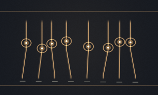
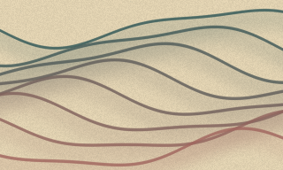
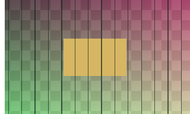
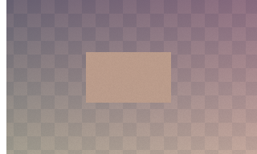

# HyperShaderFX

**A native shader and visual-effects framework for OBS Studio.**

HyperShaderFX is a native OBS shader runtime for creating reusable filters,
procedural sources, audio visualizers and transitions. Effects can use typed
controls, GPU feedback, live audio, source textures and shared computer-vision
signals without needing to start their own inference pipeline.

Unlike a general-purpose single-shader host such as
[OBS Shaderfilter](https://github.com/exeldro/obs-shaderfilter), HyperShaderFX
focuses on reusable runtime facilities and multi-stage effects. Shadertoy,
ISF, ReShade and shaderfilter-style formats are optional authoring or
porting paths, not the underlying runtime architecture.

[Included presets](data/shaders/README.md) ·
[Shader authoring](data/shaders/SHADERS.md) ·
[Build and install](#build-and-install) ·
[Sight integration](#reusing-live-latent-lab-sight-signals)

> **Development status:** Linux is the main real-renderer verification
> target. Windows and macOS are not yet qualified. This is a conservative initial
> source snapshot with a reduced native preset collection.

## Original instruments

| Brass Register | Paper Tide | Spectral Garden |
| :---: | :---: | :---: |
|  |  |  |
| Audio-reactive source | Audio-reactive source | Audio-reactive source |

| Topographic Etching | Contact Filaments | Afterimage Press |
| :---: | :---: | :---: |
|  |  |  |
| Sight depth filter | Sight hand-tracking filter | GPU feedback filter |

*Existing libobs/OpenGL fixture renders, not new live-camera captures.*
[Instrument setup and render verification](docs/original-instruments.md).

[Install locally](#build-and-install) · [Build checks](https://github.com/myrqyry/hypershader/actions) · [Distribution scope](docs/INITIAL-SNAPSHOT.md)

## What it can do

### Native OBS effect types

HyperShaderFX registers three OBS-facing effect types:

- **HyperShaderFX Filter** — apply shaders to an existing source.
- **HyperShaderFX Source** — render procedural graphics, audio visualizers, and reactive sprites directly.
- **HyperShaderFX Transition** — render shader-driven A/B scene transitions with native transition progress and audio mixing.

The same authoring model and most host controls are shared across those lanes.

### Native MediaPipe face surface

When the ONNX **Face Mesh** graph is enabled for a filter, HyperShaderFX
can expose 468 face landmarks through iLandmarks. Effects can now also
request iFaceSurface (256×256 RGBA32F GPU triangle coverage) and
iFaceTriangles (898×1 RGBA32F triangle-to-landmark IDs). The surface
stores a normalized triangle ID in R, the first two barycentric weights
in G/B, and coverage in A; the third weight is 1-G-B. The surface
clears on face loss and iFacePresent remains the authoritative gate
for effects to skip face overlays.

The opt-in **Face Mesh Wireframe** filter demonstrates this without adding a
second inference engine. The existing face detector/model path is unchanged.
Shadertastic's face topology is credited in the source header; the
rasterization code is independent and native to HyperShaderFX. This is
**face geometry**, not true selfie/person segmentation, and does not make
hand, pose, or depth graphs operational.

Standalone real-OpenGL verification: bash scripts/verify-face-surface-obs.sh.
The end-to-end ONNX → OBS → surface shader check uses a separate public
256×256 RGBA face fixture with scripts/verify-mediapipe-filter-obs.sh
and data/shaders/tests/mediapipe_face_surface_probe.effect. No face
photographs are committed to this repository.

### Shader runtime

- **Metadata-driven controls** from comments beside shader uniforms.
- **Conditional controls** with native `@show_if` expressions tied to other shader uniforms.
- **Global animation speed**, timer reset, opacity and blend controls.
- **Mouse input**, resolution/time/frame uniforms, and OBS source dimensions.
- **Four optional texture channels** backed by images, OBS sources, or audio spectrum data where supported.
- **Audio reactivity** with bass, mid, treble, and level bindings.
- **Previous-frame feedback** through `iPreviousFrame`.
- **Native two-buffer graphs** with independent A/B history for multi-stage temporal effects.
- **Source compositing** and host-level blend modes without forcing every shader to reimplement them.
- **Typed controls** for scalar, boolean, vector, and enumerated shader parameters.
- **Readable shader names and categories** while preserving stored paths and scene compatibility.

### Live audio and FFT

The existing native OBS audio engine drives eight measured bands, live PCM
and FFT textures. Optional kick/snare-region energy, spectral flux,
approximate tempo, beat phase, bar phase and confidence signals reuse the
same worker. Drum-region names do not imply isolated instruments. The
The ordinary Source includes spectrum orbit, phosphor oscilloscope and
spectral history strata. See [audio visualizer](docs/audio-visualizer.md).

### Original Instruments — first-party shader collection

Six native effects use the real HyperShaderFX signal pipeline rather
than additional third-party ports: **Brass Register**, **Paper Tide** and **Spectral Garden**
(audio-driven sources), **Topographic Etching** (Sight depth), **Contact
Filaments** (Sight hands), and **Afterimage Press** (previous GPU output).
The audio, depth, pinch and temporal controls drive real shader uniforms.
See [Original Instruments](docs/original-instruments.md) for setup,
captured previews and verification boundaries.

### Shader library and standard library

The standard library in `data/stdlib/`, native runtime effects, test fixtures,
and a conservative selection of independently authored presets remain tracked.
Imported collections, reference-based presets, and unresolved model binaries are not part of this repository. The original development repository and its history remain separate.

Retained presets include the Sight-reactive effects, native audio visualizers,
Ink Currents, Ripple Glass, Vidicon Afterglow, Optical Halation, P-Frame Drift,
Warp Tape, and independently implemented procedural sources. Existing credits
and technical references within retained shaders are preserved.

See [included presets and review status](data/shaders/README.md). Tests or
historical documentation involving excluded effects may require the local
review collection. Do not publish packages from a checkout containing
unreviewed local assets.

## Effect hotkeys

Every HyperShaderFX filter instance has **Enable effect** and **Disable
effect** actions in OBS Settings > Hotkeys, under its own filter name.
Bind both actions to the same key for a toggle (or assign separate keys).
No binding is assigned by default. OBS saves the bindings with the filter,
and changing the shader preset or renaming the filter does not replace them.
This controls the entire filter, not individual shader parameters.

Verified against actual libobs registration, routed callbacks, repeat
press/release, independent instances, saved bindings, reloading and removal
using `scripts/verify-effect-hotkeys.sh`. Reference: Spectrum's
[source hooks](https://github.com/Voidscape-Development/Spectrum/blob/8af962d220c23e7ee3bf1bd78808887203a85950/src/common/source-hooks.c);
this implementation uses our existing instance lifecycle directly.

## Visual shader builder

`tools/shader-builder/` contains a standalone visual graph builder for constructing HyperShaderFX shaders from reusable nodes.

Current builder work includes:

- native graph-to-effect generation,
- a real WebGL2 preview path,
- named colormaps,
- deterministic graph serialization,
- compile feedback from real libobs,
- native/browser contract checks,
- repair-prompt plumbing for invalid generated shaders.
- a **Reload Saved** action for the selected active HyperShader instance.
  It checks that the file open in the editor is the saved, unmodified .effect,
  then uses the existing immutable-revision Apply flow, native compile feedback
  and previous-selection rollback on failure. It does not auto-watch files,
  broadcast changes to multiple filters, or discard unsaved edits.

This is intended as a practical creative authoring surface, not a separate shader dialect. Generated output targets the same native HyperShaderFX runtime.

See [`docs/shader-builder-webgl-preview.md`](docs/shader-builder-webgl-preview.md) and [`tools/shader-builder/COLORMAPS.md`](tools/shader-builder/COLORMAPS.md).

## Portable native effect bundles

`tools/effect-packager/pack.py` can package an existing native `.effect`,
local quoted shader includes, and explicitly listed assets into a deterministic,
hash-verified `.hsfx` archive. Extraction validates the archive into a **new
directory** without installing anything or overwriting OBS state. This is a
CLI pack/unpack utility, **not yet integrated into Shader Manager or the
builder**, and it is not a Shadertastic compatibility layer.

See [portable native effect bundles](tools/effect-packager/README.md) for
commands and limitations.

## Reusing Live Latent Lab Sight signals

HyperShaderFX can consume **existing real MediaPipe Tasks tracking** from
Live Latent Lab: Sight without
launching another inference graph. This is opt-in; old OBS scenes keep the
native HyperShader MediaPipe backend unless explicitly changed.

In OBS, add **LLL.sight Tracking** to your camera/source. Choose Face,
Body, Hands & gestures or Holistic, configure the matching model, and
publish to a named tracking channel (typically `face`, `body` or `hand`).
The overlay can be disabled while tracking continues.

Then add a **HyperShaderFX Filter** on the **same camera/framing**, turn on
**Use Sight shared snapshots (tracking, matte, text, flow, depth)**, and
select the matching **Sight Tracking Channel**. The picker discovers
configured channels, including idle channels, when properties open.

For hands, choose **Sight: Hand Highlights** for thumb/index markers or
**Sight: Hand Ripples** for fingertip-driven refraction and expanding,
decaying wavefronts. Hand Ripples replaces the former standalone Sight
Touch Field filter. Both shaders consume shared landmarks and pinch
strength without a second inference model. The ripple shader includes
strength, radius, rings, speed and pinch boost controls.

HyperShader reads versioned, read-only snapshots through OBS's private
Sight receiver and uploads only changed points to its shader textures.

Shader-facing uniforms are described in
[shader authoring: Sight tracking](data/shaders/SHADERS.md). An existing
\`iLandmarks\` / \`iFacePresent\` face shader can also use Sight's 478-point
face output (first 468 for the existing triangle topology). A 750 ms
signal expiry or missing/empty tracking clears the previous result; it does
**not** freeze a face or hand at the last position.

Sight owns all face, pose, hand, gesture and expression inference. Only one
tracking source/producer is needed per channel in a given OBS process.
HyperShader's native models, depth and shader feedback remain independent.
The Sight connection does not magically align landmarks between differently
cropped/resized sources. Depth Camera can share relative inverse depth in Original source mode.

For a real foreground mask, put one enabled Sight **Subject Cutout (U2Net)**
upstream of HyperShaderFX on the same source. Select Sight's
**Diagnostic view → Original source** to avoid changing the input video,
then enable the same Sight tracking/matte switch in HyperShaderFX.
The shader receives the stabilized inference-resolution mask through
`iSegmentation`; check `iSightMattePresent > 0.5` before sampling it.
The same mask also supplies `iSightSubjectBounds`, `iSightSubjectCenter`,
`iSightSubjectCoverage`, and `iSightSubjectPresent`. Select **Sight: Subject
Frame** for an optional native corner-bracket/centroid/coverage overlay.
A separate `iSightMotionEnergy` / `iSightMotionPresent` pair reports
whole-input luma difference at inference cadence. **Sight: Motion Pulse**
uses it for subject tint/edge glow with optional audio beat modulation.
An optional Sight Text Obfuscation producer upstream can
supply local OCR line geometry (`iSightTextPresent`, `iSightTextCount`,
`iSightTextMask`, `iSightTextBounds`). Set its Treatment to Original source
and use **Sight: Text Scramble** for animated synthetic noise, opaque
black, or a mask preview. No recognized strings reach HyperShaderFX.
The optional **LLL.sight Spatial Motion (DIS)** filter can publish
a local 32×18 optical-flow grid. Put it upstream of HyperShaderFX
in Original source mode and use **Sight: Flow Warp**, **Sight: Flow Echo**, or
**Sight: Flow Sparks**, or consume the
grid in native shaders. No extra optical flow is computed by HyperShaderFX.
Consecutive Original-source Sight analysis filters may be stacked in either
order before HyperShaderFX. Transformed/unknown filters block deeper data;
use one enabled producer per type. Flow Sparks can target the subject or
background with the shared matte. Add **LLL.sight Depth Camera (Depth Anything)** in Original source (share depth) mode for
relative inverse depth. **Sight: Depth Glass** offers depth-band ripple
refraction with discontinuity checks and optional subject protection.
Flow Sparks optionally uses a chosen depth layer
with silhouette gating. Signals are independently fresh, not
frame-synchronized. No second model is started. See [the shared matte contract](docs/sight-matte-contract.md)
for geometry, freshness and verification details.

The bridge has been exercised in isolated **real OBS/libobs/OpenGL** sessions
with actual Sight tracking producers, including the consolidated Tracking
filter and Hand Ripples. Tests confirm native-size hand landmarks, evolving
ripple pixels, no-signal passthrough and signal-expiry clearing. An existing
headless teardown warning remains unresolved. This is not yet
a manual acceptance test in the normal OBS GUI. No automatic plugin
installation, activation, or model transfer is performed.

## OBS and platform compatibility

| Area | Current state |
| --- | --- |
| Linux | Primary development and real libobs/OpenGL verification target |
| Windows | Build/package workflow configured; no hosted result for this curated repository yet |
| macOS | Universal build workflow configured; no hosted result for this curated repository yet |
| OBS 31 / 32 | Main development compatibility baseline |
| OBS 33 | Image API compatibility bridge and dedicated build workflow; curated hosted result pending |
| HDR / 4K / diverse GPUs | Not comprehensively characterized yet |

Generated platform variants are currently local-only pending review. Their previously documented direct-load include limitations remain unresolved.

## Build and install

### Linux prerequisites

A typical development setup needs CMake, Ninja, pkg-config, OBS development headers and the usual graphics/build dependencies.

```bash
sudo apt-get update
sudo apt-get install -y --no-install-recommends \
  cmake ninja-build pkg-config libobs-dev libcurl4-openssl-dev libx11-dev
```

Additional verification tools used by the repository include `jq`, `clang-format`, Node.js/npm, Python, Xvfb and gersemi.

### Build

The preferred local build uses the repository preset:

```bash
cmake --preset ubuntu-x86_64
cmake --build --preset ubuntu-x86_64
```

Or configure manually:

```bash
cmake -S . -B build \
  -G Ninja \
  -DCMAKE_BUILD_TYPE=RelWithDebInfo \
  -DUSE_ONNX_RUNTIME=OFF \
  -DAUTO_ENABLE_ONNX_RUNTIME=OFF \
  -DOBS_PLUGIN_DESTINATION=bin/64bit \
  -DOBS_DATA_DESTINATION=data

cmake --build build --parallel
```

### Install locally

Install only into the user plugin directory while developing. Use a clean checkout for distributable packages; ignored local shaders may still be copied by the installer. Close OBS first.

```bash
cmake --install build_x86_64 \
  --prefix "$HOME/.config/obs-studio/plugins/hyperShaderFX"
```

For the manual `build` directory above:

```bash
cmake --install build \
  --prefix "$HOME/.config/obs-studio/plugins/hyperShaderFX"
```

Do **not** install development copies into system OBS plugin directories. A stale system copy can win plugin discovery and make a new local build appear broken or unchanged.

`install.sh` installs an already-configured and built CMake directory or a
structured Linux package. Close OBS before using it. For example:

```bash
./install.sh build_x86_64
# Or install into an isolated directory for testing:
./install.sh build_x86_64 /tmp/hypershader-install-test
```

The installer stages CMake installations before copying, preserves nested
resources and runtime libraries, and checks that the OBS 33 root module
matches the legacy module. It does not build the plugin, remove old local
presets, or turn a development checkout into a redistributable package.

### Stage a public-alpha candidate

Do not package the private working tree. To stage an isolated **candidate**
from a specific committed revision:

```bash
python3 scripts/stage-release-source.py --ref HEAD --output /tmp/hypershader-candidate.tar
mkdir /tmp/hypershader-candidate
tar -xf /tmp/hypershader-candidate.tar -C /tmp/hypershader-candidate
```

Build and package from the extracted directory, not the original checkout.
The candidate inventory in `scripts/release-assets.txt` pins the Git blob
of every tracked data file. Added or modified tracked assets require
deliberate inventory review. Ignored/uncommitted files and Git history are
not exported. Bundled ONNX, external tensor and TFLite binaries are withheld
pending redistribution review; native model inference requires separately
obtained compatible models. Core shaders do not require those binaries.

This is a mechanical staging boundary, **not** legal approval of the
included assets, a secret audit, or permission to publish. Historical
assets in the original repository still require separate review before
changing its visibility.

## Using HyperShaderFX

After installing and restarting OBS:

1. Add **HyperShaderFX Filter** to an existing source, or add a **HyperShaderFX Source** directly.
2. Choose a **Category**, then select a **Shader Preset**.
3. Tune the shader-generated controls. Read the shader-provided Notes and Credits for provenance and usage.
4. Use **Global Overrides** for host animation speed, opacity, and effect blending.
5. For shaders that request texture channels, configure the corresponding optional input slots.
6. For an authored file outside the bundled library, choose **Custom File**.

Shader categories and friendly names are presentation-only. Stored shader paths and preset IDs remain stable so browsing the library does not rewrite existing scenes.

## Writing a native HyperShaderFX shader

The simplest native shader can use the convenience `mainImage` wrapper:

```glsl
#include "../stdlib/hypershader_standard.glsl"

uniform float speed; // @min 0.0 @max 2.0 @default 1.0 @label "Speed"

void mainImage(out vec4 fragColor, in vec2 fragCoord)
{
    vec2 uv = fragCoord / iResolution.xy;
    vec3 color = 0.5 + 0.5 * cos(
        iTime * speed + uv.xyx + vec3(0.0, 2.0, 4.0)
    );

    fragColor = vec4(color, 1.0);
}

HYPERSHADER_MAINIMAGE_WRAPPER
```

HyperShaderFX can also use complete OBS techniques/passes directly; `mainImage` is a convenience form, not a required architecture.

### Metadata controls

```glsl
uniform float intensity; // @min 0.0 @max 3.0 @default 1.0 @step 0.01 @label "Intensity"
```

### Audio bindings

```glsl
uniform float pulse; // @audio "bass" @gain 3.0 @smooth 0.95
```

Supported high-level audio tags include `bass`, `mid`, `treble`, and `level`.

For the full authoring contract, see:

- [`data/shaders/SHADERS.md`](data/shaders/SHADERS.md)
- [`data/shaders/OBS_SHADER_SYNTAX.md`](data/shaders/OBS_SHADER_SYNTAX.md)
- [`docs/TWO-BUFFER-GRAPH.md`](docs/TWO-BUFFER-GRAPH.md)
- [`docs/GLOBAL-SHADER-COMPOSITING.md`](docs/GLOBAL-SHADER-COMPOSITING.md)

## Optional native integrations

The core shader runtime does not require the heavier optional integrations.

- **Qt / OBS frontend API** — enables the frontend dock and related UI tooling when configured with `ENABLE_QT=ON` and `ENABLE_FRONTEND_API=ON`.
- **ONNX Runtime** — optional MediaPipe/ML path. Real deployments require a compatible runtime and a verified loader path, not only build-time headers. See the [ONNX deployment checks](DEVELOPMENT.md#onnx-runtime-mediapipe-build).
- **LiteRT** — optional native LiteRT support, requiring an explicit LiteRT SDK/runtime configuration.

These paths are intentionally opt-in or dependency-detected and have different verification depth from the base shader runtime.

## Verification

[Build and test](.github/workflows/ci.yml) checks README links, the pinned
OBS SDK contract, shader metadata, installer behavior, source-export
fixtures and the platform-specific build payloads.
[OBS 33 compatibility](.github/workflows/obs33-compatibility.yml) is a
separate build gate on Ubuntu 26.04. Both workflows cover main and master,
use read-only repository permissions and pin checkout to a reviewed
commit. No hosted runs of this curated repository have been established
yet; passing local contract tests is not a platform qualification.


HyperShaderFX has accumulated a fairly large set of deterministic and real-renderer checks because shader code that merely compiles is not enough.

Examples:

```bash
# Native architecture / metadata / settings
python3 scripts/verify-native-boundary.py
npm run verify:settings

# OBS 32 / 33 image-channel compatibility
bash scripts/verify-image-channel-compat.sh

# Visual builder
npm run verify:shader-builder
npm run verify:shader-builder:obs
bash scripts/verify-shader-builder-browser.sh

# Native GPU/render paths
scripts/verify-two-buffer-graph.sh
scripts/verify-two-buffer-example.sh
scripts/verify-global-compositor.sh

# Shared Sight signal and hand ripple integration (explicit fixtures for live checks)
bash scripts/verify-sight-interop.sh
```

Many of these start real libobs/OpenGL sessions under Xvfb and inspect rendered pixels or actual OBS properties. They are deliberately stronger than source-text checks, but they still do not establish universal performance, HDR correctness, or visual parity across every GPU and OS.

Some historical tests still expect externally supplied presets. The initial snapshot has been qualified with the native boundary, static, settings, installer, shader builder and original-instrument renderer checks; other tests require separate requalification.

See [development notes](DEVELOPMENT.md) for build details.

## Useful documentation

- [`data/shaders/SHADERS.md`](data/shaders/SHADERS.md) — shader authoring guide
- [`data/shaders/OBS_SHADER_SYNTAX.md`](data/shaders/OBS_SHADER_SYNTAX.md) — OBS shader syntax and platform notes
- [`docs/SHADER-NAMING.md`](docs/SHADER-NAMING.md) — categories, friendly names and compatibility behavior
- [`docs/GLOBAL-SHADER-COMPOSITING.md`](docs/GLOBAL-SHADER-COMPOSITING.md) — global animation and compositing controls
- [`docs/TWO-BUFFER-GRAPH.md`](docs/TWO-BUFFER-GRAPH.md) — native A/B feedback graph
- [`docs/audio-visualizer.md`](docs/audio-visualizer.md) — audio visualization presets
- [`docs/SHADER-NOTES-CREDITS.md`](docs/SHADER-NOTES-CREDITS.md) — per-effect notes, credits and provenance

## Contributing

Pull requests are welcome. Keep changes narrow and preserve the native HyperShaderFX model: compatibility adapters should adapt external formats into the runtime rather than turn the runtime into a clone of another shader host.

When changing shader behavior, prefer a real renderer regression when practical. When changing platform/runtime compatibility, verify against the relevant OBS ABI rather than assuming a successful compile proves runtime compatibility.

## License

The repository includes the GNU General Public License version 2 text in [`LICENSE`](LICENSE). Runtime third-party notices are collected in [data/licenses](data/licenses/README.md). Individual shaders may carry additional attribution/license notes; see their headers and [`docs/SHADER-NOTES-CREDITS.md`](docs/SHADER-NOTES-CREDITS.md).
