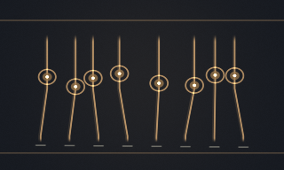
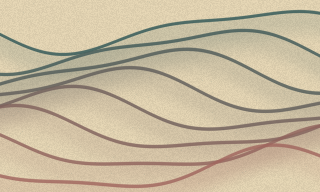
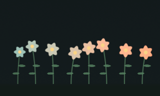
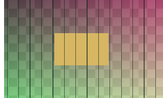
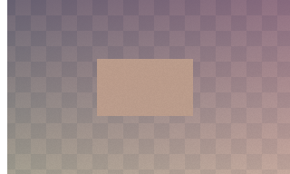

# Original Instruments — six first-party hypershader effects

These are newly authored, native hypershader effects built around
its real signal/texture contracts. The collection has **three standalone
sources and three live-video filters**. No shader ports or imported
code were used to write them.

| Effect file in data/shaders/root/ | OBS role | Dynamic input |
| --- | --- | --- |
| source.brass_register.effect | Source | Eight measured audio bands, kick, time |
| source.paper_tide.effect | Source | Eight audio bands, beat envelope/phase, time |
| source.spectral_garden.effect | Source | Eight measured audio bands, kick, time |
| filter.topographic_etch.effect | Filter | Sight depth texture, beat |
| filter.contact_filaments.effect | Filter | Sight 21-point hands, pinch, audio |
| filter.afterimage_press.effect | Filter | Previous rendered output, spectral flux |

## Rendered previews
These are actual libobs/OpenGL rendered frames with controlled fixture signals,
not screenshots of an installed live OBS scene.

**Brass Register**

**Paper Tide**

**Spectral Garden**

**Topographic Etching**

**Contact Filaments**

**Afterimage Press**

## Setup

**Brass Register**, **Paper Tide** and **Spectral Garden** — Add hypershader Source,
choose the named native effect file, and choose the live Audio Source
in hypershader. In silence the effects retain a deliberate quiet
composition. Audio moves separate, genuinely measured frequency-band
features; these shaders do not claim to measure additional FFT bins.

**Spectral Garden** connects each of eight blossoms to one existing FFT
band; the existing kick signal opens the flowers, while the idle wind
animates without audio. The shader adds no models, audio worker or history
texture. Choose an Audio Source in hypershader to see its response.

**Topographic Etching** — On the *same source*, add
LLL.sight Depth Camera (Depth Anything) **above** hypershader
with its Original source / share depth output mode. Enable
**Use Sight shared snapshots (tracking, matte, text, flow, depth)**
on hypershader. This effect maps relative (not metric) depth values
into engraved contour lines. Absent current depth means exact
passthrough; no fake depth or extra inference engine is launched.

**Contact Filaments** — Add LLL.sight Tracking in Hands & gestures
mode, with overlay disabled, upstream on the same source. Select a
shared hand channel, enable Sight shared snapshots in hypershader,
and select that channel. Actual wrist/fingertip coordinates become
copper threads, with pearl nodes. Audio and pinch change the
appearance. Missing current hand landmarks means exact passthrough.

**Afterimage Press** — Add to video as a hypershader Filter.
It uses the existing GPU previous-output history passed through
`hs_history`, not a simulated time-based ghost. The
current source alpha is retained. A selected audio source can change
the plate registration with measured spectral flux.

The three sources use hypershader's **first-party native standard
library** and are not plain OBS Shaderfilter files.

## Verification and scope

- `bash scripts/verify-original-instruments.sh OUTPUT_DIR`
  checks all six original files and compiles/renders them with
  **real libobs/OpenGL pixel readback**. Different audio, depth, hand,
  pinch and prior-image fixture inputs change real pixels; source
  alpha is invariant between compared states.
- `bash scripts/verify-original-instruments-plugin.sh`
  loads the **actual hypershader module** under isolated OBS,
  shows all three original sources animated, confirms the two Sight
  filters preserve the camera image without a signal, and confirms
  the feedback filter changes and evolves across moving image
  frames. No normal OBS profile is touched.
- The source-hashed images in `data/shaders/root/previews/`
  are genuine captured libobs/OpenGL frames at **320×192**, with fixture
  signals/images. They do not claim a live webcam or microphone was
  running when the images were captured.
- This verification ran with Mesa llvmpipe software OpenGL; real RTX 2070
  SUPER frame-time cost is not benchmarked. The source smoke exercises
  playback without a selected live microphone, not end-to-end audio capture.
- End-to-end inference for *these exact two new Sight filters*,
  interactive GUI acceptance, long-duration playback, benchmarked
  1080p/4K GPU cost, and Windows/macOS rendering parity remain open.

All prior preset imports remain untracked. These six effects and
the source-hashed previews are independently maintained new work.
